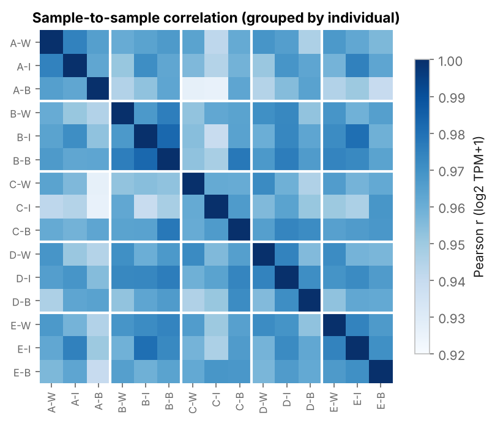
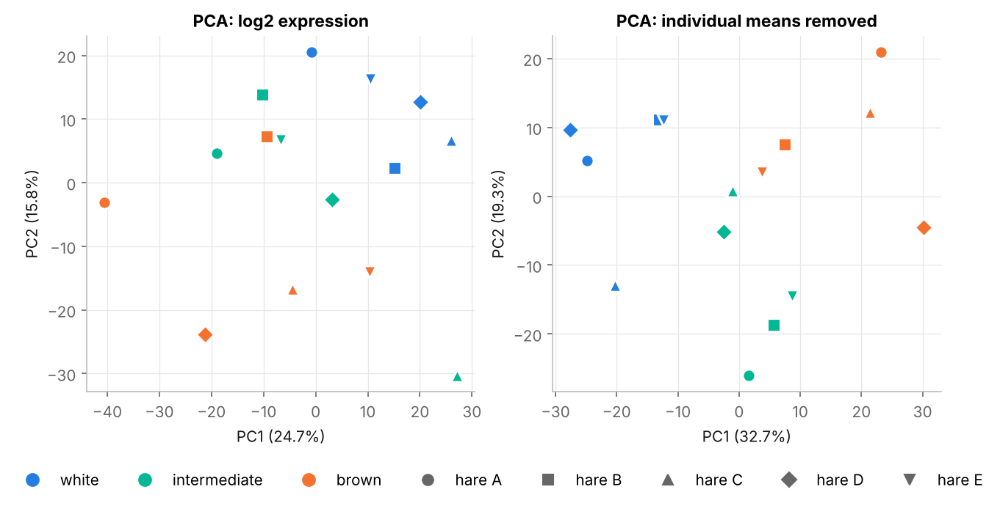
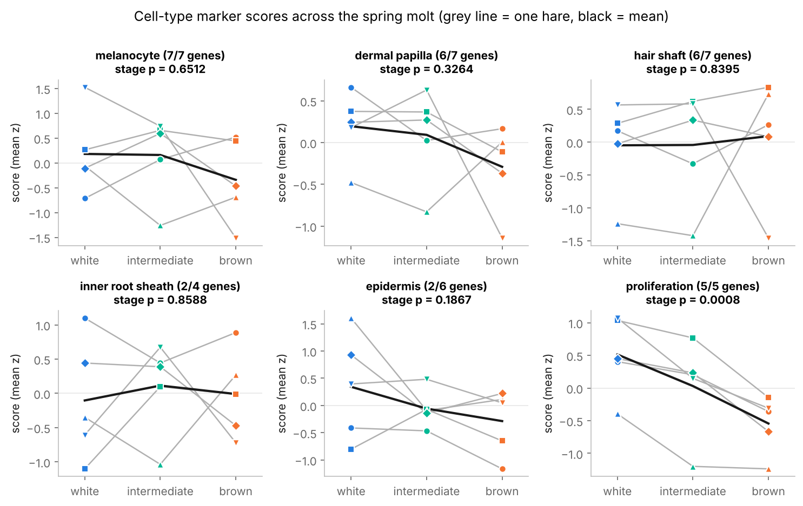
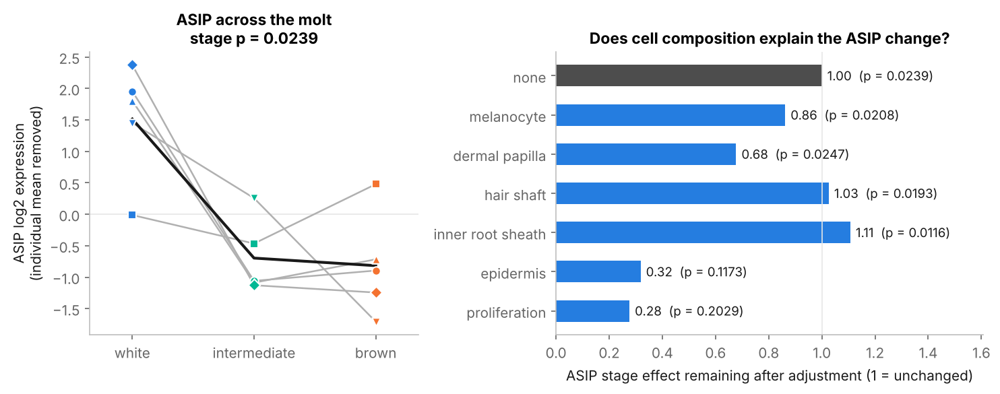

# 눈덧신토끼 털갈이: 어구티 변화는 조절일까, 피부 구성 변화일까?


눈덧신토끼(*Lepus americanus*)는 같은 개체가 겨울엔 흰색, 여름엔 갈색으로 털색을 바꿉니다.
기존 연구(Ferreira et al. 2017)는 봄 털갈이 단계별 피부 전사체를 유전자 하나씩 비교해, 털색 유전자 **어구티(ASIP)** 가 흰색 단계에서 높다는 것을 보였습니다.

그런데 털갈이 중인 피부는 모낭이 자라고 멈추면서 **세포 구성 자체가 바뀝니다.**
그래서 어구티 발현이 달라졌을 때, 세포가 조절을 바꾼 건지 어구티를 만드는 세포가 늘어난 건지 구분할 수 없습니다.

이 레포는 같은 공개 데이터를 **유전자 하나가 아니라 세포 유형 표지 유전자 묶음 단위로** 다시 분석해 이 질문에 답합니다.

## 분석 방법

| 단계 | 내용 |
|---|---|
| 1. 데이터 | 5마리 × 털갈이 3단계(W 흰색, I 중간, B 갈색) = 15샘플, TPM ≥ 1 필터, log2(TPM+1) |
| 2. 품질 확인 | 샘플 간 상관, PCA (원래 값 / 개체 평균 제거 후) |
| 3. 세포 유형 표지 점수 | 멜라닌세포, 진피유두, 모간, 내근초, 표피, 세포분열 표지 유전자의 z-점수 평균 ([`config/marker_sets.tsv`](config/marker_sets.tsv)) |
| 4. 어구티 보정 | 어구티 단계 효과를 각 표지 점수로 보정했을 때 얼마나 남는지 |
| 5. 통계 | 개체 안에서만 단계 라벨을 섞는 **정확 순열검정** (6⁵ = 7,776가지 전부) |

- 같은 개체에서 세 단계를 모두 채취한 짝지은 설계라, 모든 비교는 **개체 평균을 뺀 값**으로 합니다.
- 무작위 요소가 없는 정확 검정이라 **어느 컴퓨터에서 돌려도 결과가 같습니다.**
- 원 논문이 발현 차이 유전자로 보고한 유전자(KRT71, RUNX1 등)는 순환 논리를 피하려고 표지 세트에서 뺐습니다.

## 바로 실행 (시연용)

```bash
git clone https://github.com/<아이디>/hare-molt-skin.git
cd hare-molt-skin
pip install -r requirements.txt
python run_all.py            # 분석 전체 (1분 이내)
python scripts/verify.py     # 저장된 기준 결과와 같은지 확인 → "재현 성공"
```

Windows, macOS, Linux 모두 Python만 있으면 됩니다. 인터넷이 없어도 됩니다(분석용 데이터가 레포에 포함).

## 주요 결과 (실제 데이터)

1. **개체 차이가 크다.** 원래 값의 PCA에서는 개체가 섞여 있지만, 개체 평균을 빼면 PC1을 따라 흰색 → 중간 → 갈색 순으로 정렬됩니다. 짝지은 설계에서 개체 효과를 빼야 하는 이유입니다.
2. **어구티는 흰색 단계에서 높다.** 평균 TPM 13.7(흰색) vs 1.9(중간) vs 1.6(갈색), 개체 내 정확 순열검정 p = 0.024. 원 논문의 결과를 다른 방법으로 재확인했습니다.
3. **세포 유형 점수 중 단계에 따라 뚜렷이 변하는 것은 세포분열 점수뿐이다** (p = 0.0008, 흰색 단계에서 가장 높음). 멜라닌세포·진피유두·모간 점수는 단계 효과가 유의하지 않았습니다.
4. **어구티 변화는 세포분열 상태와 구분되지 않는다.** 세포분열 점수로 보정하면 어구티 단계 효과의 28%만 남고(p = 0.20), 멜라닌세포(86% 남음)나 진피유두(68% 남음)로 보정하면 대부분 남습니다(p < 0.05).

→ 어구티 발현 변화는 멜라닌세포나 진피유두 세포의 양으로는 설명되지 않고, 모낭주기의 세포분열 상태와 함께 움직입니다. 다만 표지 점수는 세포 비율을 직접 잰 값이 아니므로, 이는 원인이 아니라 "함께 변한다"는 관찰입니다. 표피 세트는 6개 중 2개 유전자만 찾아서 해석하지 않았습니다.

## 결과 파일

`run_all.py` 를 실행하면 아래 파일이 만들어집니다. 숫자 요약은 [`results/summary.md`](results/summary.md) 에 자동으로 정리됩니다.

| 그림 | 내용 |
|---|---|
|  | 샘플 간 상관 (개체별로 묶음) |
|  | PCA: 개체 평균을 빼면 단계별로 갈라지는지 |
|  | 세포 유형 표지 점수의 단계별 변화 (회색 선 = 한 마리) |
|  | 어구티 단계 효과가 표지 점수 보정 후 얼마나 남는지 |

| 표 (`results/tables/`) | 내용 |
|---|---|
| `stage_tests.tsv` | 표지 점수와 어구티의 단계 효과, 정확 p값 |
| `asip_adjusted.tsv` | 보정 변수별 개체 내 상관, 남은 단계 효과 비율, 보정 후 p값 |
| `marker_scores.tsv` | 샘플별 표지 점수 |
| `marker_coverage.tsv` | 표지 유전자 중 실제로 찾은 것 / 없는 것 |
| `pca_coordinates.tsv` | PCA 좌표 |

## 재현성 확인

- `python scripts/verify.py` : 방금 만든 결과표를 레포의 기준 결과(`results/reference/`)와 비교합니다. 숫자는 상대 오차 10⁻⁶ 까지 같으면 일치로 봅니다.
- `python tests/test_pipeline.py` : 실제 데이터 없이 합성 데이터로 전체 흐름을 검증합니다. 효과를 심어 둔 데이터에서 그 효과만 정확히 찾아내는지, 같은 입력으로 두 번 돌렸을 때 결과가 같은지 확인합니다.

## 데이터 준비 (처음 한 번만)

분석용 데이터(`data/processed/`)는 이미 레포에 들어 있으므로 이 단계는 필요 없습니다. 원자료부터 다시 만들고 싶을 때만 실행하세요.

1. [`data/raw/README.md`](data/raw/README.md) 의 파일을 Dryad에서 내려받아 `data/raw/` 에 둡니다.
2. 실행:

```bash
python scripts/prepare_data.py --tar data/raw/Lep_ame_RSEM.out.genes.results.tar \
    --fasta data/raw/Lep_ame_filtered_skin_transcriptome.fasta \
    --biomart data/raw/biomart_rabbit.tsv data/raw/biomart_mouse.tsv
```

- 샘플 이름에서 개체(A–E)와 단계(W/I/B)를 자동으로 읽습니다. 확실하지 않으면 `data/processed/samples_template.tsv` 를 만들고 멈추니, 채운 뒤 `--samples` 로 다시 실행합니다.
- 유전자 이름은 Trinity 조각 → Ensembl ID(FASTA 헤더) → 유전자 기호(BioMart) 순서로 붙입니다. 처리 기록은 `data/processed/prepare_report.txt` 에 남습니다.

3. `python run_all.py` → `python scripts/verify.py --update` 로 기준 결과를 저장하고 커밋합니다.

## 레포 구조

```
hare-molt-skin/
├── run_all.py               # 분석 전체 실행
├── hare/                    # 분석 코드 (data, stats, figures)
├── config/marker_sets.tsv   # 세포 유형 표지 유전자
├── data/processed/          # 분석용 발현표 (커밋됨)
├── data/raw/                # Dryad 원자료 (커밋 안 함)
├── results/                 # 그림, 표, 요약, 기준 결과
├── scripts/prepare_data.py  # 원자료 → 분석용 데이터
├── scripts/verify.py        # 재현성 확인
└── tests/                   # 합성 데이터 기반 전체 흐름 테스트
```

## 한계

- 개체가 5마리라 가능한 가장 작은 p값은 6/7,776 ≈ 0.0008 입니다.
- 표지 점수는 세포 비율을 직접 잰 값이 아니라 표지 유전자 발현의 평균입니다.
- 보정 변수도 단계를 따라 변하므로, 보정 후 효과가 줄었다는 것은 "구성 변화와 구분되지 않는다"는 뜻이지 원인을 증명한 것은 아닙니다.
- 유전자 이름은 de novo 전사체를 토끼·마우스 참조에 대응시킨 주석에 의존합니다. 실제로 찾은 표지 유전자는 `marker_coverage.tsv` 에서 확인하세요.

## 확장 계획

1. 마우스 피부·모낭 단일세포 RNA-seq을 참조로 쓰는 본격적인 세포 비율 분해(deconvolution)
2. 산토끼(*L. timidus*) 가을 털갈이(갈색 → 흰색) 데이터에서 같은 결과가 나오는지 재현
3. 색 변화 방향이 반대인 두 털갈이에서, 어구티가 색 방향과 모낭주기 중 무엇을 따라가는지 비교

## 데이터 출처

Ferreira M.S. et al. (2017) The transcriptional landscape of seasonal coat colour moult in the snowshoe hare. *Molecular Ecology*.
데이터: Dryad doi:[10.5061/dryad.7v1m1](https://doi.org/10.5061/dryad.7v1m1) · 원시 리드: SRA SRR5468532–SRR5468561

## 라이선스

코드는 [MIT](LICENSE). `data/processed/` 의 발현 데이터는 위 Dryad 자료에서 파생되었으며 Dryad 이용 조건을 따릅니다.
